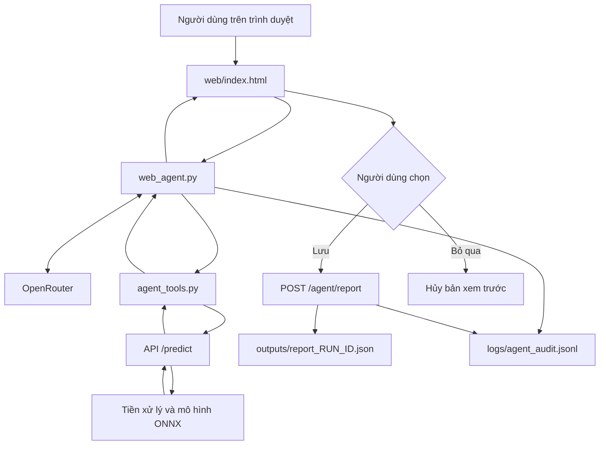

# Thiết kế hệ thống — HTTM_ECG

## 1. Mục đích và phạm vi

Hệ thống phân loại nhịp ECG từ bản ghi đã thu nhận, sử dụng phần tiền xử lý của TV1 và mô hình CNN + RR của TV2.

TV3 tích hợp mô hình vào API, đóng gói Docker, xây dựng Agent gọi công cụ và kiểm tra tính nhất quán, hiệu năng.

Phiên bản hiện tại dùng ONNX FP32 trên CPU. Agent chỉ truy cập bản ghi MIT-BIH 100 đã được cho phép.

## 2. Sơ đồ kiến trúc

```mermaid

flowchart TD

&#x20;   User["Người dùng"] --> Agent["agent_main.py"]

&#x20;   Agent <-->|"Yêu cầu công cụ và tóm tắt"|LLM["OpenRouter LLM"]

&#x20;   Agent -->|"Gọi công cụ được phép"|Tools["agent_tools.py"]

&#x20;   Data["ECG gốc và chú thích trên máy"] --> Tools

&#x20;   Tools <-->|"HTTP nội bộ"|API["FastAPI /predict"]

&#x20;   API --> Pre["Tiền xử lý TV1"]

&#x20;   Pre --> Norm["Chuẩn hóa theo TV2"]

&#x20;   Norm --> Model["ONNX Runtime CPU"]

&#x20;   Config["Cấu hình và model TV2"] --> Norm

&#x20;   Config --> Model

&#x20;   Model -->|"Xác suất từng nhịp"|API

&#x20;   Tools -->|"Metadata và thống kê"|Agent

&#x20;   Agent --> Audit["Nhật ký audit"]

&#x20;   Agent --> Review{"Người dùng xác nhận lưu?"}

&#x20;   Review -->|"y"|Report["Báo cáo JSON"]

&#x20;   Review -->|"n hoặc hủy"|Cancel["Không lưu báo cáo"]

```

agent_main điều phối các vòng gọi LLM và công cụ. LLM đề nghị gọi công cụ; agent_tools thực hiện kiểm tra quyền truy cập và gọi API.

ECG gốc và chú thích được xử lý trên máy. Nội dung trả về LLM gồm metadata và thống kê tổng hợp, không chứa toàn bộ tín hiệu ECG.

Báo cáo chỉ được ghi sau khi chương trình nhận xác nhận y từ người dùng.

## 3. Luồng xử lý một bản ghi

### 3.1. Đọc dữ liệu

agent_tools đọc các tệp cố định:

- data/mitdb/100.hea

- data/mitdb/100.dat

- data/mitdb/100.atr

WFDB chuyển tín hiệu sang biên độ vật lý. Chọn MLII nếu có; nếu không có thì chọn kênh 0. Kiểm tra fs=360 Hz và đơn vị mV.

Chỉ giữ các vị trí chú thích thuộc ánh xạ AAMI của TV1. Không dùng nhãn chú thích làm đầu vào phân loại của mô hình.

### 3.2. Gọi API

Agent gửi ECG gốc chưa lọc, fs và toàn bộ đỉnh R đã chọn vào POST /predict.

Đỉnh R ở biên vẫn được gửi để giữ đúng ngữ cảnh RR, dù nhịp đó có thể bị bỏ qua khi cắt cửa sổ.

API kiểm tra độ dài, giá trị hữu hạn, kiểu dữ liệu, thứ tự và phạm vi vị trí R.

### 3.3. Tiền xử lý

preprocessing.py thực hiện:

1\. Lọc toàn bộ tín hiệu bằng Butterworth 0,5–40 Hz, order=2, filtfilt.

2\. Tính RR_pre và RR_post trên toàn bộ đỉnh R đã chọn.

3\. Tính RR_local_avg theo code TV1.

4\. Cắt signal[R-90:R+144].

5\. Bỏ nhịp thiếu cửa sổ và lưu lý do.

6\. Tạo ECG float32 [N, 1, 234] và RR float32 [N, 3].

Không tính lại RR sau khi bỏ nhịp biên.

### 3.4. Suy luận mô hình

model_runner.py đọc inference_config.json và normalization.json.

Chuẩn hóa ECG và RR đúng một lần, ngoài ONNX. Phép tính chuẩn hóa dùng float64 rồi chuyển đầu vào ONNX thành float32 liên tục trong bộ nhớ.

ONNX Runtime chạy trên CPU, chia tối đa 256 nhịp mỗi batch nội bộ.

Đầu ra ONNX đã là xác suất theo thứ tự N, S, V, F, Q. Không áp dụng softmax thêm.

Chọn nhãn bằng argmax.

### 3.5. Trả kết quả và tổng hợp

API trả:

- mode và model_version.

- class_order.

- processed_count và skipped_count.

- Nhãn, xác suất và vị trí R của từng nhịp được xử lý.

- Vị trí R và lý do của từng nhịp bị bỏ qua.

agent_tools kiểm tra cấu trúc kết quả, số nhịp, vị trí R, lớp dự đoán và xác suất. Sau đó đếm nhãn theo lớp để trả số liệu tổng hợp cho agent_main.

LLM tóm tắt số liệu này bằng tiếng Việt. Bản tóm tắt và số liệu API được hiển thị cho người dùng trước khi hỏi lưu.

## 4. Trách nhiệm các thành viên và bàn giao

| Thành viên | Phần phụ trách | Đầu ra dùng để tích hợp |
|---|---|---|
| TV1 | Dữ liệu, lọc, cắt nhịp, RR, chia DS1/DS2 | Notebook tiền xử lý, cấu hình, ds1_data.npz, ds2_data.npz |
| TV2 | Huấn luyện và đánh giá CNN/CNN + RR, xuất mô hình | ONNX, inference_config.json, normalization.json, sample_io và kết quả đánh giá |
| TV3 | API, Docker, Agent, kiểm thử và tài liệu tích hợp | Code dịch vụ, Dockerfile, script kiểm tra, benchmark và tài liệu |

Notebook huấn luyện và toàn bộ bộ dữ liệu không cần nằm trong Docker image phục vụ suy luận.

Các đánh giá phân loại, khoảng tin cậy và phân tích sai số của TV1/TV2 vẫn phải được bàn giao để tổng hợp báo cáo cuối cùng.

## 5. Thành phần triển khai

| Thành phần | Vai trò |
|---|---|
| main.py | Endpoint, kiểm tra request, nạp mô hình khi khởi động |
| preprocessing.py | Lọc, RR, cắt nhịp và xử lý biên |
| model_runner.py | Chuẩn hóa và chạy ONNX |
| agent_tools.py | Danh sách công cụ, bản ghi được phép và tổng hợp kết quả |
| agent_main.py | LLM tool calling, audit và xác nhận lưu |
| models/tv2/ | Model và cấu hình triển khai |
| data/ | Dữ liệu cục bộ, không commit mặc định |
| logs/ | Nhật ký Agent |
| outputs/ | Báo cáo và bằng chứng kiểm tra |

## 6. Docker và lưu trữ

Docker image chứa code, thư viện, cấu hình và ONNX.

Khi chạy container:

- API nghe tại cổng 8000 trong container.

- Cổng máy chủ bind vào 127.0.0.1:8000.

- data/ được mount read-only vào /app/data.

- logs/ được mount vào /app/logs.

- outputs/ được mount vào /app/outputs.

- Biến môi trường được nạp từ .env khi chạy.

Dữ liệu và báo cáo nằm trên máy chủ, không phụ thuộc vào vòng đời container.

Bản ghi không được đóng sẵn trong image. Máy mới cần chuẩn bị dữ liệu được phép trước khi chạy Agent.

## 7. Giới hạn truy cập và xử lý lỗi

| Tình huống | Hành vi |
|---|---|
| Thiếu model hoặc cấu hình sai | API khởi động thất bại |
| Request không hợp lệ | HTTP 422 |
| Nhịp thiếu cửa sổ | Bỏ nhịp, trả vị trí và lý do |
| Tất cả nhịp thiếu cửa sổ | Trả HTTP 200, processed_count=0, beats rỗng |
| Lỗi suy luận | HTTP 500; không tự tạo nhãn hoặc chuyển sang mock |
| Công cụ ngoài danh sách | Từ chối |
| Bản ghi ngoài danh sách | Từ chối |
| Tham số đường dẫn bổ sung | Từ chối |
| Địa chỉ API ngoài danh sách | Từ chối |
| Agent chưa có kết quả API | Không tạo báo cáo hoàn chỉnh |
| Người dùng nhập n, hủy hoặc đóng đầu vào | Không lưu báo cáo |

LLM không có công cụ shell, đọc đường dẫn tùy ý hoặc ghi báo cáo trực tiếp.

Giới hạn Agent không thay thế hệ thống xác thực cho một dịch vụ công khai. Phiên bản hiện tại được triển khai cục bộ.

## 8. Kiểm tra và bằng chứng

| Script | Mục đích |
|---|---|
| check_tv2_model.py | Đối chiếu chuẩn hóa và xác suất ONNX với sample_io |
| check_real_ecg.py | Đối chiếu bản ghi 100 với TV1 và API |
| check_api_contract.py | Kiểm tra đầu vào sai và giới hạn công cụ |
| benchmark_api.py | Đo 100 request, tải tương đương một giờ và RAM |

Các kết quả đo và phạm vi kiểm tra được trình bày trong PERFORMANCE_RESULTS.md.

Các quy ước đầu vào, mục tiêu và phương pháp đo nằm trong TECHNICAL_REQUIREMENTS.md.

## 9. Giới hạn hiện tại

- Chưa có bộ phát hiện R; cần vị trí R được cung cấp.

- filtfilt và RR_post cần dữ liệu sau thời điểm nhịp; hệ thống phục vụ xem lại bản ghi.

- Agent chỉ hỗ trợ bản ghi 100 trong danh sách cố định.

- Đối chiếu end-to-end dữ liệu thật mới thực hiện trên bản ghi 100.

- Chưa đo nhiều client đồng thời hoặc triển khai qua mạng ngoài localhost.

- Độ trễ API không bao gồm thời gian gọi LLM.

- Kết quả dự đoán không phải chẩn đoán hoặc đề xuất điều trị.

## Bổ sung kiến trúc giao diện web

Giao diện web và API ECG chạy trong cùng ứng dụng FastAPI, cùng container Docker. Agent dòng lệnh vẫn được giữ lại.



### Các endpoint bổ sung

| Endpoint | Vai trò |
|---|---|
| `GET /` | Trả giao diện `web/index.html` |
| `GET /agent/config` | Trả trạng thái cấu hình key, tên mô hình yêu cầu và tình trạng dữ liệu được phép |
| `POST /agent/chat` | Nhận yêu cầu cùng lịch sử giới hạn, điều phối LLM và công cụ |
| `POST /agent/report` | Tiếp nhận quyết định lưu hoặc bỏ bản xem trước |

### Luồng xử lý và lưu báo cáo

1. Trình duyệt gửi yêu cầu tới backend; API key OpenRouter chỉ được sử dụng ở backend.
2. Backend cung cấp hai công cụ `list_records` và `classify_record` cho LLM.
3. Công cụ kiểm tra tham số và quyền truy cập; chỉ chấp nhận bản ghi 100.
4. Khi phân loại, công cụ đọc ECG cùng chú thích trên máy và gọi `/predict`.
5. LLM nhận metadata và số liệu tổng hợp từ công cụ, không nhận toàn bộ tín hiệu ECG qua công cụ.
6. Backend trả bản tóm tắt và số liệu API để người dùng xem.
7. Nếu có kết quả phân loại, backend tạo bản xem trước trong bộ nhớ, kèm run ID và token riêng.
8. Chọn lưu gửi quyết định xác nhận tới `/agent/report`; backend tạo file JSON trong `outputs`.
9. Chọn bỏ qua hủy bản xem trước và không tạo file báo cáo.

Backend kiểm tra Origin khi trình duyệt gửi header này, token của bản xem trước và xác nhận lưu. Các cơ chế này không thay thế một hệ thống đăng nhập và phân quyền nhiều người dùng.

### Giới hạn vận hành

- Tối đa hai lượt Agent đang xử lý đồng thời.
- Mỗi lượt tối đa sáu vòng gọi LLM và tám yêu cầu gọi công cụ.
- Lịch sử đầu vào tối đa sáu tin nhắn, với giới hạn độ dài do backend kiểm tra.
- Tối đa 64 bản xem trước trong bộ nhớ; hết hạn sau một giờ. Khi đạt giới hạn, bản cũ nhất được loại bỏ.
- Khởi động lại container làm mất các bản xem trước chưa lưu.
- Báo cáo và nhật ký đã ghi được giữ trên máy qua bind mount.
- LLM không có công cụ chạy shell, đọc tệp tùy ý hay trực tiếp lưu báo cáo.
- Lời tóm tắt có thể sai; số liệu API được hiển thị riêng để đối chiếu.
- Thay đổi system prompt hoặc HTML cần build image và tạo lại container để có hiệu lực.
